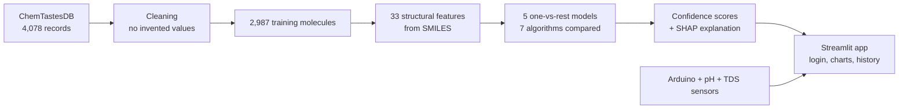

# Artificial Taste Perception: Explainable ML for Taste Prediction and an E-Tongue Prototype

> Predicts the **basic taste (Salty, Sweet, Umami, Bitter, Sour)** of a molecule from its chemical structure, explains every prediction, scores how trustworthy the underlying data label is, and connects to a low-cost **Arduino pH + TDS electronic-tongue prototype**.

   

---

## 1. Results at a glance

| Metric (5-fold stratified cross-validation, 2,987 molecules) | Random Forest | Logistic Regression (baseline) | Majority-class baseline |
| --- | --- | --- | --- |
| Overall 5-class accuracy | **84.7%** | 61.4% | 51.6% |
| Macro F1 | **0.714** | 0.460 | n/a |
| Weighted F1 | **0.847** | 0.633 | n/a |

- **5 independent one-vs-rest models**, one per taste, each chosen after comparing **7 algorithms**.
- Random Forest had the **best ROC-AUC on all five tastes (0.931 to 0.989)**.
- Severe **class imbalance** (16 Salty vs 1,541 Bitter molecules) handled explicitly. See [Section 6](#6-how-class-imbalance-is-handled).
- Every number in this README was computed from the data and models in this repository. Where a result is weak, it is reported as weak.

*Overall 5-class figures use each molecule's highest taste score across the five models, based on out-of-fold predictions, so no molecule is scored by a model that trained on it.*

---

## 2. The problem

Taste is normally judged by human panels, which is slow, subjective and expensive. Electronic tongues (E-tongues) use sensors to measure liquids, but they need a way to turn measurements into a taste label, and they need reference knowledge about which chemicals taste like what.

This project asks two questions:

1. **Can the taste of a compound be predicted from its chemical structure alone?**
2. **Can the prediction be made explainable and honest about its reliability, so it is useful for an E-tongue / Dravya identification workflow?**

---

## 3. The solution



**Four modules in the app**

| Module | What it does | Method |
| --- | --- | --- |
| 5-Taste Prediction | Picks a sample or any SMILES, shows editable structural measurements, scores all five tastes, names the dominant taste and explains why | Five Random Forest models + SHAP |
| Sample Data-Quality | Scores how reliable the dataset label for that sample is (0 to 100) | Transparent 5-check rule, 20 points each |
| Wine Quality | Predicts quality from 11 chemical measurements | Random Forest on WineQT (1,143 wines) |
| Coffee Quality | Totals eight cupping scores against the 80-point specialty cutoff | Rule-based total compared with the coffee dataset |

---

## 4. Data

**Source:** ChemTastesDB, a curated database of tastants (Excel file with 4,078 rows and 8 columns: ID, Name, PubChem CID, CAS number, canonical SMILES, Taste, Class taste, Reference).

| Class in the raw file | Molecules | Used for the 5 models |
| --- | --- | --- |
| Bitterness | 1,615 | Yes |
| Sweetness | 1,313 | Yes |
| Umaminess | 220 | Yes |
| Sourness | 49 | Yes |
| Saltiness | 16 | Yes |
| Non-sweetness, Tastelessness, Multitaste, Miscellaneous, Non-bitterness | 862 | No (do not map to one basic taste) |

### Cleaning (nothing was invented or imputed)

| Step | Records | Reason |
| --- | --- | --- |
| Raw file | 4,078 | Starting point |
| Blank rows and non-basic-taste classes removed | 3,213 | Keep the five basic tastes only |
| Stereo-label conflicts removed | -81 | Same flat 2D SMILES with contradictory taste labels (for example D-valine is sweet and L-valine is bitter) |
| Duplicate SMILES removed | -145 | Prevents the same molecule appearing in both train and test folds |
| Invalid SMILES | 0 | Defensive check |
| **Final training set** | **2,987** | |

All negatives for each model are real molecules of the other four tastes.

### Features (33, computed from SMILES)

Atom counts (C, N, O, S, P, halogens, metal ions), approximate molecular weight, ring, branch, double-bond and triple-bond counts, aromatic atoms, charge and ion flags, and ratios (O/C, N/C, S/C). The featurizer is deterministic and has no RDKit dependency (see [Limitations](#10-limitations-stated-honestly)).

---

## 5. Models and algorithm selection

Seven algorithms were compared **for every taste** with identical cross-validation folds: Logistic Regression, KNN, SVM (RBF), Random Forest, Extra Trees, Gradient Boosting and Histogram Gradient Boosting.

**Cross-validated ROC-AUC (the selection metric)**

| Taste | Positives | LogReg | KNN | SVM | **Random Forest** | Extra Trees | Grad. Boost | Hist. GB |
| --- | --- | --- | --- | --- | --- | --- | --- | --- |
| Salty | 16 | 0.968 | 0.589 | 0.908 | **0.989** | 0.857 | 0.883 | 0.985 |
| Sweet | 1,161 | 0.801 | 0.912 | 0.863 | **0.945** | 0.927 | 0.916 | 0.936 |
| Umami | 220 | 0.938 | 0.912 | 0.936 | **0.970** | 0.943 | 0.968 | 0.963 |
| Bitter | 1,541 | 0.803 | 0.894 | 0.857 | **0.931** | 0.917 | 0.895 | 0.920 |
| Sour | 49 | 0.902 | 0.815 | 0.944 | **0.961** | 0.922 | 0.933 | 0.954 |

**Why Random Forest**
- Highest ROC-AUC on all five tastes in the training script's comparison. For Umami, Random Forest and Gradient Boosting are statistically tied (the standalone notebook's re-run scores both at 0.968), so either is defensible.
- Handles non-linear feature interactions (for example the O/C ratio combined with ring and bond counts) without feature scaling.
- Resists overfitting on small positive classes better than boosting and provides feature importances and SHAP explanations.
- Linear models are the weakest on Sweet and Bitter, because those classes need feature interactions.
- KNN and SVM collapse on Salty (precision and recall 0.000), as 16 positives give them too few close neighbours.

**Final Random Forest results per taste (out-of-fold, default 0.5 threshold)**

| Taste | ROC-AUC | Accuracy | Precision | Recall | F1 |
| --- | --- | --- | --- | --- | --- |
| Salty | 0.989 | 0.995 | 0.667 | 0.250 | 0.364 |
| Sweet | 0.945 | 0.879 | 0.858 | 0.825 | 0.841 |
| Umami | 0.970 | 0.964 | 0.793 | 0.695 | 0.741 |
| Bitter | 0.931 | 0.860 | 0.867 | 0.860 | 0.863 |
| Sour | 0.961 | 0.986 | 0.625 | 0.306 | 0.411 |

In the combined 5-class prediction the per-taste F1 is: Bitter 0.871, Sweet 0.853, Umami 0.752, Salty 0.621, Sour 0.474.

Full metrics for every algorithm are in `models/taste_models/taste_models_info.json` and `results/taste_model_comparison_report.md`. Per-algorithm ROC grids are in `visuals/`.

---

## 6. How class imbalance is handled

The five tastes are badly imbalanced: Bitter 1,541, Sweet 1,161, Umami 220, Sour 49 and Salty 16 molecules in the training data. A model that always answers "not salty" would be 99.5% accurate and completely useless. These are the controls used:

| Technique | How it is applied | Why |
| --- | --- | --- |
| **One-vs-rest models** | One binary model per taste, instead of one multi-class model | Each taste gets its own algorithm comparison and honest weakness report. Large classes cannot hide small ones. |
| **Class weighting** | `class_weight="balanced"` for Logistic Regression, SVM, Random Forest and Extra Trees | Errors on rare positives cost more during training, with no synthetic data created. |
| **Stratified K-fold** | 5 folds, `random_state=42`, stratified on each taste | Every fold keeps the same positive ratio, so no fold has zero Salty examples. |
| **Imbalance-aware metrics** | ROC-AUC is the selection metric. Precision, recall and F1 are reported with accuracy | Accuracy rewards ignoring the minority class. |
| **Macro and weighted F1** | Reported for the combined 5-class result | Macro F1 treats all tastes equally, so weak rare-class performance is visible. |
| **Deduplication and conflict removal** | 145 duplicates and 81 stereo conflicts removed | Prevents leakage that would inflate rare-class scores. |
| **No oversampling** | SMILES-derived data was not synthetically inflated | Oversampling 16 molecules (for example with SMOTE) would produce invented chemistry. |

**The honest outcome:** Salty (16) and Sour (49) have high ROC-AUC but low recall (0.250 and 0.306), so the models rank them well but still miss most true positives at the default threshold. The app flags those two tastes as "directional only". The real fix is more data, ideally E-tongue measurements of salt solutions at graded concentrations.

---

## 7. Explainability and the Confidence Score

- **Confidence Score** (deliberately not called "probability"): the share of the 400 trees in the forest that vote for the taste.

  `Confidence = trees voting for the taste / 400`

  It is not a calibrated probability, and the five scores are independent, so they need not sum to 1. The dominant taste is the highest score.
- **SHAP TreeExplainer** shows the top features that pushed each prediction up or down (the app falls back to an approximate method and says so if `shap` is not installed).
- **Most influential features** (Random Forest importance): Umami N/C ratio (0.196) then O/C ratio; Bitter O/C ratio (0.141) then SMILES length; Sweet number of double bonds (0.097) and O/C ratio (0.096). These match known chemistry, since umami compounds are nitrogen-rich amino-acid derivatives.

---

## 8. Application (Streamlit)

- Login gate and prediction history page (`app/pages/1_History.py`, logged to `history_log.csv`).
- **Two-section sample picker:** five quick samples (Caffeine, D-Glucose, Citric acid, Sodium chloride, Adenosine 5'-monophosphate) or the full ChemTastesDB list.
- Editable structural measurements (the taste equivalent of the wine inputs), live prediction and plain-language explanation.
- Charts chosen by data type and purpose: ranked bar and donut (scores and share), waterfall (feature contributions), cumulative line (position within a taste class), scatter (all molecules), gauge (data-quality score), 100% stacked bar (reliability tiers by taste), bullet and confidence curve (wine), diverging bar (how unusual each reading is), distribution curve and dumbbell (coffee).

---

## 9. Hardware prototype (E-tongue demo)

An Arduino is connected to a **pH sensor and a TDS (conductivity) sensor**, and the readings reach the website.

- **Calibration:** pH 4 and pH 7 buffer solutions made with distilled water, which has near-zero dissolved ions and gives a clean, repeatable baseline.
- **Reference samples:** a salt-in-distilled-water solution (higher TDS) for the salty reference, and lemon juice (pH about 2 to 2.5) for the sour reference.
- **What it can and cannot detect:** pH identifies acidity (sour) and TDS identifies dissolved ions (salty). Sweet, bitter and umami molecules barely change either, so they need extra sensors or the structure-based models. Real mixtures (seawater, borewell water) contain many ions, so these sensors cannot identify a specific compound.

*(Add your wiring diagram and photo here, for example `docs/hardware_setup.jpg`.)*

---

## 10. Limitations (stated honestly)

1. **Features are approximate.** RDKit could not be installed in the build environment, so a hand-written deterministic featurizer is used. Morgan fingerprints and RDKit descriptors are the highest-value upgrade.
2. **Salty (16) and Sour (49) are underpowered.** Their recall is low and their scores should be treated as directional.
3. **No hyperparameter search and no scaffold-based split.** Similar molecules can sit in different folds, so scores are likely somewhat optimistic.
4. **One label per molecule.** Real tastes are mixed and concentration-dependent.
5. **Structure-only models cannot analyse water samples.** Plain water or a mixture is not a molecule. The pH and TDS prototype is the right tool for that, with limited taste coverage.
6. **Scores are not calibrated probabilities.**

## 11. Future work

- Replace the featurizer with RDKit fingerprints and descriptors.
- Add scaffold-aware cross-validation and nested-CV hyperparameter tuning.
- Calibrate scores (isotonic or Platt scaling) and add an "Unknown" output for far-from-training samples.
- Collect E-tongue sensor responses for graded salt, sugar, acid and bitter solutions, and train a sensor-to-taste model.
- Add more sensors (conductivity array, voltammetric electrodes) to separate sweet, bitter and umami.

---

## 12. Repository structure

```text
artificial taste 2/
├── datasets/                      # ChemTastesDB cleaned CSVs, WineQT, coffee_quality
├── models/
│   ├── train_models.py            # original wine and coffee training
│   └── taste_models/
│       ├── smiles_featurizer.py   # 33 structure descriptors
│       ├── prepare_training_data.py
│       ├── train_taste_models.py  # 7-algorithm comparison, saves best per taste
│       ├── predict_taste.py       # command-line prediction
│       ├── *_model.pkl            # 5 trained taste models
│       └── taste_models_info.json # every metric for every algorithm
├── notebooks/                     # 01-05: EDA, SHAP explainability, algorithm comparison
├── app/
│   ├── app_taste_prediction.py    # main Streamlit app (5-taste, quality, wine, coffee)
│   ├── chart_helpers.py           # chart functions
│   ├── auth_history.py            # login and history log
│   ├── app.py                     # original wine and coffee app
│   └── pages/1_History.py
├── results/taste_model_comparison_report.md
├── visuals/                       # per-algorithm ROC grids for 5 tastes, wine, coffee
└── requirements.txt
```

---

## 13. Run it locally

```bash
git clone <your-repo-url>
cd "artificial taste/artificial taste 2"
python -m venv venv
venv\Scripts\activate            # Windows   (macOS/Linux: source venv/bin/activate)
pip install -r requirements.txt

# Optional: retrain all five taste models (a few minutes)
cd models/taste_models
python train_taste_models.py
python predict_taste.py "CN1C=NC2=C1C(=O)N(C(=O)N2C)C"   # caffeine

# Launch the app
cd ../../app
streamlit run app_taste_prediction.py
```

---

## 14. Skills demonstrated

Data cleaning without imputation, imbalanced classification, one-vs-rest modelling, cross-validated model comparison, baseline benchmarking, feature engineering from chemical strings, explainable AI (SHAP), honest evaluation, Streamlit app development, data visualisation, and sensor hardware integration (Arduino, pH, TDS).

---

## 15. Data licence and citation

The ChemTastesDB data is licensed **CC BY-NC-ND**. Cite the original database (see its source page) when using it, use it for non-commercial work, and do not redistribute modified copies publicly. The WineQT and coffee datasets are used under their original terms. Check each source before publishing data files in a public repository.

## 16. Author

**Thrisha K**, B.Tech Computer Science and Data Science, KNS Institute of Technology, Bengaluru.
Add your LinkedIn and email here.
